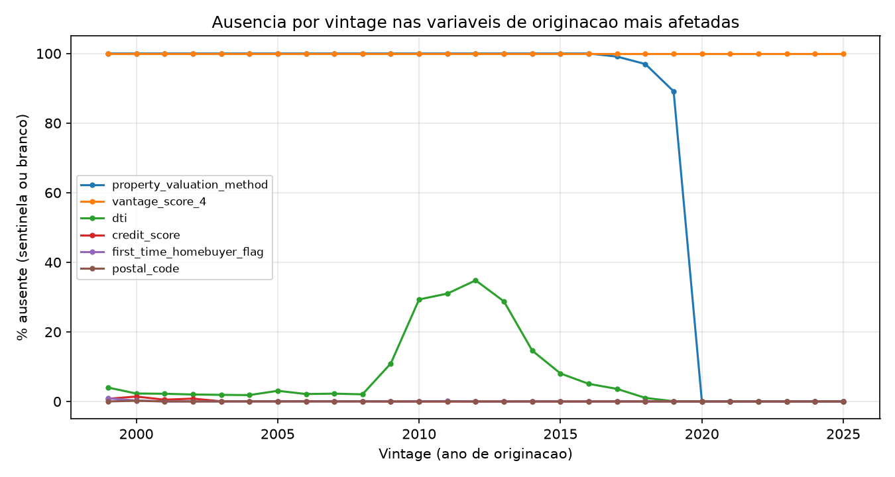

# Relatorio de Qualidade de Dados

Gerado em 2026-10-25 por `uv run poe dq-report` (somente agregados).

## 1. Volumetria e reconciliacao (arquivo -> bronze)
| tabela | arquivos | linhas_arquivo | carregadas | rejeitadas |
|---|---|---|---|---|
| orig | 27 | 1.350.000 | 1.350.000 | 0 |
| perf | 27 | 74.919.968 | 74.919.968 | 0 |

## 2. Bronze -> Silver
| tabela | bronze | silver | diferenca |
|---|---|---|---|
| perf | 74.919.968 | 74.919.968 | 0 |
| orig | 1.350.000 | 1.350.000 | 0 |

A diferenca em `orig` corresponde a loans duplicados na bronze (regra R01); `perf` nao remove linhas.

## 3. Regras de consistencia de negocio
| rule_id | table_name | severity | description | n_checked | n_failed | pct_failed | suggested_action |
|---|---|---|---|---|---|---|---|
| R01 | orig | warn | loan_id duplicado na bronze_orig (loans com mais de uma linha) | 1.350.000 | 0 | 0.00% | manter 1 linha por loan (arquivo mais recente) e registrar |
| R02 | orig | warn | credit_score fora de 300-850 (apos sentinela) | 1.347.887 | 0 | 0.00% | tratar como ausente |
| R03 | orig | warn | dti fora de 0-65 (apos sentinela) | 1.254.498 | 0 | 0.00% | tratar como ausente |
| R04 | orig | warn | mi_pct fora de 0-55 (apos sentinela) | 1.349.981 | 0 | 0.00% | tratar como ausente |
| R05 | orig | warn | cltv menor que ltv (o guia diz que cltv seria "nao disponivel") | 1.349.954 | 0 | 0.00% | investigar; flag |
| R06 | orig | warn | maturity_date <= first_payment_date | 1.350.000 | 0 | 0.00% | excluir ou flag |
| R07 | orig | warn | original_loan_term diferente de (maturity - first_payment + 1) em meses | 1.350.000 | 0 | 0.00% | flag |
| R08 | orig | error | original_upb nulo ou <= 0 | 1.350.000 | 0 | 0.00% | excluir |
| R09 | orig | warn | original_interest_rate fora de (0, 20] | 1.350.000 | 0 | 0.00% | investigar |
| R10 | orig | warn | property_state diferente de 2 letras maiusculas | 1.350.000 | 0 | 0.00% | flag |
| R11 | orig | error | loan_id fora do formato PYYQnXXXXXXX | 1.350.000 | 0 | 0.00% | investigar |
| R12 | orig | warn | ano do loan_id difere da vintage do arquivo | 1.350.000 | 1 | 0.00% | investigar |
| R13 | perf | error | loans na performance sem registro de originacao (orfaos) | 1.349.995 | 0 | 0.00% | excluir da modelagem |
| R14 | orig | warn | loans na originacao sem nenhuma linha de performance | 1.350.000 | 5 | 0.00% | excluir da modelagem |
| R15 | perf | error | linhas duplicadas por (loan_id, periodo) | 74.919.968 | 0 | 0.00% | deduplicar |
| R16 | perf | warn | current_actual_upb nulo ou negativo | 74.919.968 | 0 | 0.00% | flag |
| R17 | perf | warn | zero_balance_code preenchido com current_actual_upb > 0 | 1.007.408 | 0 | 0.00% | investigar |
| R18 | perf | warn | linhas com periodo posterior ao evento de saldo zero | 51.994.265 | 7 | 0.00% | excluir linhas pos-evento |
| R19 | perf | warn | loans com buraco na serie mensal (meses esperados != linhas) | 1.349.995 | 195 | 0.01% | flag; tratar na construcao do painel |
| R20 | perf | warn | actual_loss preenchido com zero_balance_code fora de 02/03/09/15 | 19.639 | 0 | 0.00% | investigar |
| R21 | perf | info | actual_loss ausente em zero_balance_code 02/03/09/15 (esperado nos 3 ultimos meses e em defeitos) | 21.156 | 1.517 | 7.17% | censura no LGD: tratar na modelagem |
| R22 | perf | info | net_sales_proceeds positivo (guia: recuperacoes sao negativas) | 19.638 | 72 | 0.37% | verificar convencao de sinal |
| R23 | perf | warn | loan_age difere dos meses desde first_payment_date (loans nao modificados) | 73.781.293 | 20.508 | 0.03% | usar idade recalculada |
| R24 | perf | error | loan_id fora do formato PYYQnXXXXXXX | 74.919.968 | 0 | 0.00% | investigar |

## 4. Variaveis com mais ausentes (brancos + sentinelas)
| table_name | column_name | n_blank | n_sentinel | pct_ausente |
|---|---|---|---|---|
| orig | vantage_score_4 | 0 | 1.350.000 | 100.00% |
| perf | defect_settlement_date | 74.914.321 | 0 | 99.99% |
| perf | total_expenses | 74.900.424 | 0 | 99.97% |
| perf | non_mi_recoveries | 74.900.424 | 0 | 99.97% |
| perf | miscellaneous_expenses | 74.900.424 | 0 | 99.97% |
| perf | maintenance_preservation_costs | 74.900.424 | 0 | 99.97% |
| perf | taxes_insurance | 74.900.424 | 0 | 99.97% |
| perf | mi_recoveries | 74.900.424 | 0 | 99.97% |
| perf | legal_costs | 74.900.424 | 0 | 99.97% |
| perf | net_sales_proceeds | 74.900.330 | 0 | 99.97% |
| perf | delinquent_accrued_interest | 74.900.329 | 0 | 99.97% |
| perf | actual_loss | 74.900.329 | 0 | 99.97% |
| perf | delinquency_due_to_disaster | 74.690.509 | 0 | 99.69% |
| perf | borrower_assistance_plan | 74.630.285 | 0 | 99.61% |
| perf | ddlpi | 74.561.733 | 0 | 99.52% |

## 5. Falhas de conversao de tipo (valor existia mas nao converteu)
Nenhuma.

## 6. Conclusoes e riscos para a modelagem
_(a preencher a mao apos ler as tabelas acima: o que muda no target, nas features e na amostra)_
