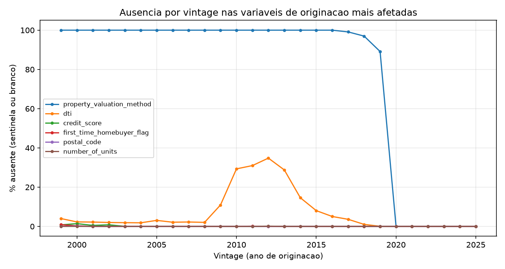

# Relatorio de Qualidade de Dados

Gerado em 2026-11-05 por `uv run poe dq-report` (somente agregados).

## 1. Volumetria e reconciliacao (arquivo -> bronze)
| tabela | arquivos | linhas_arquivo | carregadas | rejeitadas |
|---|---|---|---|---|
| orig | 27 | 1.350.000 | 1.350.000 | 0 |
| perf | 27 | 74.919.968 | 74.919.968 | 0 |

## 2. Bronze -> Silver
| tabela | bronze | silver | diferenca |
|---|---|---|---|
| perf | 74.919.968 | 74.919.968 | 0 |
| orig | 1.350.000 | 1.350.000 | 0 |

Nenhum loan duplicado na originacao e nenhuma linha removida na performance.

## 3. Regras de consistencia de negocio
| rule_id | table_name | severity | description | n_checked | n_failed | pct_failed | suggested_action |
|---|---|---|---|---|---|---|---|
| R01 | orig | warn | loan_id duplicado na bronze_orig (loans com mais de uma linha) | 1.350.000 | 0 | 0.00% | manter 1 linha por loan (arquivo mais recente) e registrar |
| R02 | orig | warn | credit_score fora de 300-850 (apos sentinela) | 1.347.887 | 0 | 0.00% | tratar como ausente |
| R03 | orig | warn | dti fora de 0-65 (apos sentinela) | 1.254.498 | 0 | 0.00% | tratar como ausente |
| R04 | orig | warn | mi_pct fora de 0-55 (apos sentinela) | 1.349.981 | 0 | 0.00% | tratar como ausente |
| R05 | orig | warn | cltv menor que ltv (o guia diz que cltv seria "nao disponivel") | 1.349.954 | 0 | 0.00% | investigar; flag |
| R06 | orig | warn | maturity_date <= first_payment_date | 1.350.000 | 0 | 0.00% | excluir ou flag |
| R07 | orig | warn | original_loan_term diferente de (maturity - first_payment + 1) em meses | 1.350.000 | 0 | 0.00% | flag |
| R08 | orig | error | original_upb nulo ou <= 0 | 1.350.000 | 0 | 0.00% | excluir |
| R09 | orig | warn | original_interest_rate fora de (0, 20] | 1.350.000 | 0 | 0.00% | investigar |
| R10 | orig | warn | property_state diferente de 2 letras maiusculas | 1.350.000 | 0 | 0.00% | flag |
| R11 | orig | error | loan_id fora do formato PYYQnXXXXXXX | 1.350.000 | 0 | 0.00% | investigar |
| R12 | orig | warn | ano do loan_id difere da vintage do arquivo | 1.350.000 | 1 | 0.00% | investigar |
| R13 | perf | error | loans na performance sem registro de originacao (orfaos) | 1.349.995 | 0 | 0.00% | excluir da modelagem |
| R14 | orig | warn | loans na originacao sem nenhuma linha de performance | 1.350.000 | 5 | 0.00% | excluir da modelagem |
| R15 | perf | error | linhas duplicadas por (loan_id, periodo) | 74.919.968 | 0 | 0.00% | deduplicar |
| R16 | perf | warn | current_actual_upb nulo ou negativo | 74.919.968 | 0 | 0.00% | flag |
| R17 | perf | warn | zero_balance_code preenchido com current_actual_upb > 0 | 1.007.408 | 0 | 0.00% | investigar |
| R18 | perf | warn | linhas com periodo posterior ao evento de saldo zero | 51.994.265 | 7 | 0.00% | excluir linhas pos-evento |
| R19 | perf | warn | loans com buraco na serie mensal (meses esperados != linhas) | 1.349.995 | 195 | 0.01% | flag; tratar na construcao do painel |
| R20 | perf | warn | actual_loss preenchido com zero_balance_code fora de 02/03/09/15 | 19.639 | 0 | 0.00% | investigar |
| R21 | perf | info | actual_loss ausente em zero_balance_code 02/03/09/15 (esperado nos 3 ultimos meses e em defeitos) | 21.156 | 1.517 | 7.17% | censura no LGD: tratar na modelagem |
| R22 | perf | info | net_sales_proceeds positivo (guia: recuperacoes sao negativas) | 19.638 | 72 | 0.37% | verificar convencao de sinal |
| R23 | perf | warn | loan_age difere dos meses desde first_payment_date (loans nao modificados) | 73.781.293 | 20.508 | 0.03% | usar idade recalculada |
| R24 | perf | error | loan_id fora do formato PYYQnXXXXXXX | 74.919.968 | 0 | 0.00% | investigar |
| R25 | perf | warn | loans sem saldo zero cujo ultimo periodo e anterior ao corte dos dados (serie truncada) | 1.349.995 | 0 | 0.00% | tratar como censurado ou investigar |
| R26 | orig | error | first_payment_date nulo (idade e observabilidade incalculaveis) | 1.350.000 | 0 | 0.00% | excluir da modelagem |
| R27 | perf | warn | loans com mais de uma linha de saldo zero (mais de um evento de termino) | 1.349.995 | 0 | 0.00% | investigar; usar o ultimo evento |
| R28 | orig | warn | 1o pagamento incompativel com o trimestre do loan_id (fora de 0-8 meses; modificados/convertidos reiniciam a data) | 1.350.000 | 5.628 | 0.42% | excluir da amostra de PD (idade incalculavel) |

## 4. Ausentes e sentinelas
### 4.1 Originacao: variaveis com informacao ausente (brancos + sentinelas)
| column_name | n_blank | n_sentinel | pct_ausente |
|---|---|---|---|
| special_eligibility_program | 1.308.941 | 0 | 96.96% |
| pre_harp_loan_id | 1.266.527 | 0 | 93.82% |
| property_valuation_method | 0 | 1.042.606 | 77.23% |
| msa | 284.473 | 0 | 21.07% |
| dti | 0 | 95.502 | 7.07% |
| credit_score | 0 | 2.113 | 0.16% |
| first_time_homebuyer_flag | 0 | 753 | 0.06% |
| number_of_borrowers | 0 | 195 | 0.01% |
| postal_code | 0 | 103 | 0.01% |
| number_of_units | 0 | 75 | 0.01% |
| property_type | 0 | 66 | 0.00% |
| channel | 0 | 49 | 0.00% |
| cltv | 0 | 46 | 0.00% |
| ltv | 0 | 43 | 0.00% |
| mi_pct | 0 | 19 | 0.00% |
| loan_purpose | 0 | 3 | 0.00% |

### 4.2 Originacao: variaveis sem informacao (ausentes em ~100% das linhas) - candidatas a remocao
| column_name | n_blank | n_sentinel | pct_ausente |
|---|---|---|---|
| vantage_score_4 | 0 | 1.350.000 | 100.00% |

### 4.3 Performance: ausencia ESTRUTURAL (campos so preenchidos em eventos; nao e sujeira)
| column_name | n_blank | n_sentinel | pct_ausente |
|---|---|---|---|
| defect_settlement_date | 74.914.321 | 0 | 99.99% |
| miscellaneous_expenses | 74.900.424 | 0 | 99.97% |
| legal_costs | 74.900.424 | 0 | 99.97% |
| mi_recoveries | 74.900.424 | 0 | 99.97% |
| total_expenses | 74.900.424 | 0 | 99.97% |
| non_mi_recoveries | 74.900.424 | 0 | 99.97% |
| maintenance_preservation_costs | 74.900.424 | 0 | 99.97% |
| taxes_insurance | 74.900.424 | 0 | 99.97% |
| net_sales_proceeds | 74.900.330 | 0 | 99.97% |
| delinquent_accrued_interest | 74.900.329 | 0 | 99.97% |
| actual_loss | 74.900.329 | 0 | 99.97% |
| delinquency_due_to_disaster | 74.690.509 | 0 | 99.69% |

## 5. Falhas de conversao de tipo (valor existia mas nao converteu)
Nenhuma.

## 6. Conclusoes e riscos para a modelagem
> Rascunho gerado a partir dos números do relatório. **Revise e ajuste** antes de publicar.

### Leitura geral
- **A estrutura está íntegra:** 27 arquivos por tabela, 1.350.000 loans e 74.919.968 registros mensais reconciliados sem perda (0 rejeitadas), sem duplicatas na originação nem na performance e sem órfãos.
- **Valores fora de faixa não aparecem** (R02 a R11 sem falhas). O guia da Freddie Mac já marca valores fora do intervalo como "não disponível", então a dificuldade deste dataset é **semântica** (sentinelas, ausência estrutural, censura, evolução do layout) e de **escala**, não de formato.
- **Todas as séries sem evento de saldo zero chegam ao corte dos dados** (R25 = 0): não há loans "sumidos" no meio do período.
- No encerramento de todo loan com saldo zero, o saldo atual é 0 (R17 = 0). O saldo anterior ao evento está em `zero_balance_removal_upb`, a base natural do EAD.

### Problemas encontrados e tratamento
| Achado | Tamanho | Tratamento |
|---|---|---|
| Loans na originação sem nenhuma linha de performance (R14) | 5 | Fora do dataset de PD (`has_perf = false`) |
| Linhas com período posterior ao saldo zero (R18) | 7 linhas | Impacto desprezível; documentado, sem filtro especial |
| Buracos na série mensal (R19) | 195 loans (0,01%) | Mantidos; idade recalculada pelas datas |
| `loan_age` do arquivo diverge da idade recalculada (R23) | 20.508 linhas (0,03%) | Usar sempre a idade recalculada |
| Ano do `loan_id` difere da vintage do arquivo (R12) | 1 loan | Investigar com `uv run poe inspect-dq`; sem impacto no modelo |
| `net_sales_proceeds` positivo (R22) | 72 de 19.638 (0,37%) | Verificar a convenção de sinal na fase de LGD |
| `actual_loss` ausente em evento de crédito (R21) | 1.517 de 21.156 (7,17%) | **Censura no LGD**: esperada nos 3 últimos meses antes do corte; tratar na modelagem |

Há perda realizada para 19.639 eventos de crédito (21.156 − 1.517), o universo disponível para o LGD.

### Variáveis: o que a ausência significa
| Variável | Ausente | Interpretação e decisão |
|---|---|---|
| `vantage_score_4` | 100% | Sem informação no Sample: **removida** do dataset de PD |
| `property_valuation_method` | 77,23% | Hipótese: campo só informado em safras recentes. Se confirmado em `reports/tables/dq_missing_by_vintage.csv`, é um **proxy de tempo** e arrisca vazamento no split out-of-time: não usar no scorecard sem tratar |
| `special_eligibility_program` | 96,96% | Ausência **estrutural** (sem programa especial): virar categoria "nenhum", não imputar |
| `pre_harp_loan_id` | 93,82% | Só existe em refinanciamentos HARP: derivar indicador `is_harp_refi` e descartar o id |
| `msa` | 21,07% | Branco = fora de MSA: categoria "sem MSA" |
| `dti` | 7,07% | Manter com `dti_was_missing`; testar se a ausência é preditiva (hipótese: parte vem de loans HARP) |
| `credit_score` | 0,16% | Manter com `credit_score_was_missing` |

Na performance, a ausência de custos, recuperações e perda (~99,97%) é **estrutural**: esses campos só são preenchidos no encerramento de loans com evento de crédito.

### Implicações para a modelagem
1. Eventos de crédito são raros (21.156 em 1,35 milhão de loans, cerca de 1,6%): a validação out-of-time precisa checar o número de eventos por vintage.
2. A ausência de informação precisa de tratamento explícito (flags e categorias) e **não** de imputação cega.
3. O LGD parte de ~19,6 mil perdas realizadas e precisa lidar com a censura recente.
