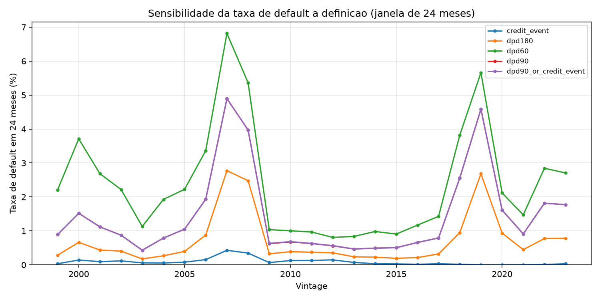
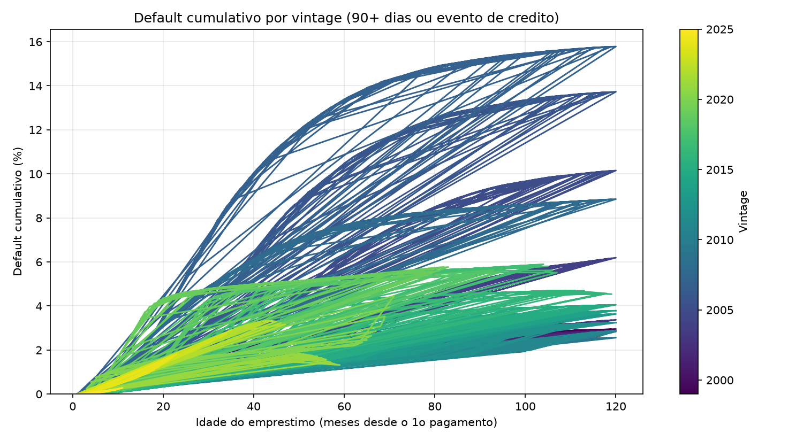

# Relatorio de Definicao de Default

Gerado em 2026-11-05 por `uv run poe default-report` (somente agregados).
Corte de dados (ultimo periodo de performance): **2026-03**. Idade = meses desde o primeiro pagamento.

## 1. Estados terminais (todas as vintages)
| estado_terminal | loans | pct |
|---|---|---|
| ativo no corte (censurado) | 342.587 | 25.38% |
| liquidado: prepago ou vencido (ZB 01) | 976.210 | 72.31% |
| liquidado: evento de credito (ZB 02/03/09/15) | 21.156 | 1.57% |
| liquidado: outra remocao (ZB 16/96) | 10.042 | 0.74% |

## 2. Candidatos a default por vintage (vida inteira, % dos loans)
Vintages recentes ainda estao censuradas: as taxas delas vao subir com o tempo.

| vintage | loans | dpd60 | dpd90 | dpd180 | evento_credito | dpd90_ou_evento |
|---|---|---|---|---|---|---|
| 1999 | 50.000 | 6.55% | 3.46% | 1.93% | 0.94% | 3.46% |
| 2000 | 50.000 | 6.67% | 3.50% | 2.20% | 1.31% | 3.50% |
| 2001 | 50.000 | 5.80% | 3.23% | 1.98% | 1.21% | 3.24% |
| 2002 | 50.000 | 5.57% | 3.40% | 2.31% | 1.34% | 3.40% |
| 2003 | 50.000 | 6.00% | 4.07% | 2.78% | 1.46% | 4.07% |
| 2004 | 50.000 | 9.70% | 7.10% | 5.20% | 3.09% | 7.11% |
| 2005 | 50.000 | 13.69% | 11.00% | 8.58% | 5.70% | 11.03% |
| 2006 | 50.000 | 16.85% | 14.33% | 11.73% | 8.14% | 14.43% |
| 2007 | 50.000 | 18.98% | 16.49% | 13.48% | 8.97% | 16.53% |
| 2008 | 50.000 | 11.26% | 9.32% | 7.23% | 4.27% | 9.34% |
| 2009 | 50.000 | 4.26% | 3.19% | 2.21% | 1.09% | 3.21% |
| 2010 | 50.000 | 4.30% | 3.24% | 2.13% | 1.00% | 3.26% |
| 2011 | 50.000 | 4.24% | 3.09% | 2.00% | 0.76% | 3.09% |
| 2012 | 50.000 | 4.60% | 3.43% | 2.20% | 0.76% | 3.44% |
| 2013 | 50.000 | 5.33% | 3.82% | 2.34% | 0.62% | 3.82% |
| 2014 | 50.000 | 5.40% | 3.87% | 2.37% | 0.42% | 3.87% |
| 2015 | 50.000 | 5.44% | 4.10% | 2.44% | 0.27% | 4.10% |
| 2016 | 50.000 | 6.30% | 4.73% | 2.75% | 0.19% | 4.73% |
| 2017 | 50.000 | 7.49% | 5.83% | 3.63% | 0.20% | 5.83% |
| 2018 | 50.000 | 6.88% | 5.42% | 3.46% | 0.14% | 5.42% |
| 2019 | 50.000 | 6.99% | 5.57% | 3.40% | 0.10% | 5.57% |
| 2020 | 50.000 | 3.13% | 2.26% | 1.29% | 0.05% | 2.26% |
| 2021 | 50.000 | 3.06% | 2.01% | 1.00% | 0.05% | 2.01% |
| 2022 | 50.000 | 5.15% | 3.49% | 1.69% | 0.12% | 3.49% |
| 2023 | 50.000 | 3.56% | 2.43% | 1.19% | 0.10% | 2.43% |
| 2024 | 50.000 | 1.89% | 1.23% | 0.49% | 0.02% | 1.23% |
| 2025 | 49.995 | 0.37% | 0.14% | 0.04% | 0.00% | 0.14% |

## 3. Taxa de default em 24 meses (definicao primaria: 90+ dias ou evento de credito)
| vintage | loans_obs_24m | defaults_24m | taxa_24m | alerta |
|---|---|---|---|---|
| 1999 | 50.000 | 446 | 0.89% |  |
| 2000 | 50.000 | 760 | 1.52% |  |
| 2001 | 50.000 | 560 | 1.12% |  |
| 2002 | 50.000 | 437 | 0.87% |  |
| 2003 | 50.000 | 216 | 0.43% |  |
| 2004 | 50.000 | 395 | 0.79% |  |
| 2005 | 50.000 | 526 | 1.05% |  |
| 2006 | 50.000 | 968 | 1.94% |  |
| 2007 | 50.000 | 2.449 | 4.90% |  |
| 2008 | 50.000 | 1.988 | 3.98% |  |
| 2009 | 50.000 | 317 | 0.63% |  |
| 2010 | 50.000 | 343 | 0.69% |  |
| 2011 | 50.000 | 316 | 0.63% |  |
| 2012 | 50.000 | 284 | 0.57% |  |
| 2013 | 50.000 | 234 | 0.47% |  |
| 2014 | 50.000 | 247 | 0.49% |  |
| 2015 | 50.000 | 253 | 0.51% |  |
| 2016 | 50.000 | 330 | 0.66% |  |
| 2017 | 50.000 | 397 | 0.79% |  |
| 2018 | 50.000 | 1.279 | 2.56% |  |
| 2019 | 50.000 | 2.292 | 4.58% |  |
| 2020 | 50.000 | 807 | 1.61% |  |
| 2021 | 50.000 | 456 | 0.91% |  |
| 2022 | 49.998 | 908 | 1.82% |  |
| 2023 | 49.964 | 886 | 1.77% |  |
| 2024 | 7.479 | 161 | 2.15% |  |
| 2025 | 0 | 0 |  | sem janela de 24m |

## 4. Gatilhos dos defaults
| gatilho | loans | pct_dos_defaults |
|---|---|---|
| so 90+ dias (sem evento de credito) | 45.855 | 68.43% |
| so evento de credito (sem 90+ previo) | 142 | 0.21% |
| ambos | 21.014 | 31.36% |

## 5. Curas (loans que chegaram a 90+ dias)
| grupo | loans | pct_dos_90plus |
|---|---|---|
| chegaram a 90+ dias | 66.869 | 100.00% |
| voltaram a ficar em dia depois (cura) | 43.576 | 65.17% |
| 90+ e depois prepagaram (sem evento de credito) | 23.449 | 35.07% |

## 6. Modificacoes
| grupo | loans | pct |
|---|---|---|
| loans modificados em algum momento | 18.359 | 1.36% |
| defaults que foram modificados | 17.626 | 26.30% |

## 7. Prontidao para LGD
Eventos de credito com `actual_loss` ausente (regra R21): 1.517 de 21.156 (7.17%). Esperado nos 3 ultimos meses antes do corte e em defeitos; tratar como censura.

## 8. Decisao (D-002)
_(a preencher a mao: gatilho, janela, tratamento de cura e de prepagamento, com base nas tabelas acima)_
