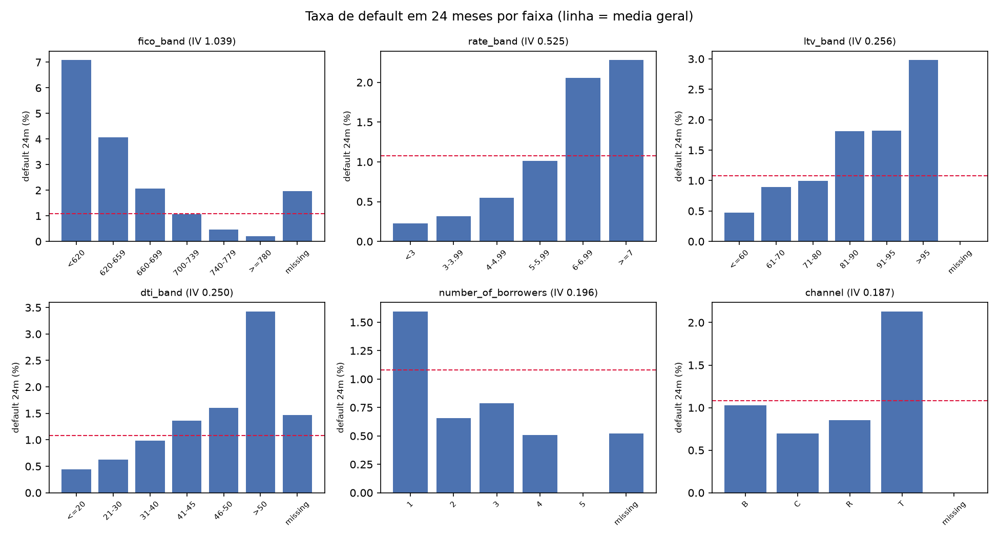
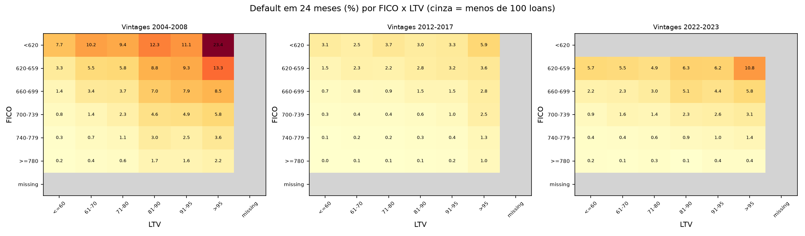
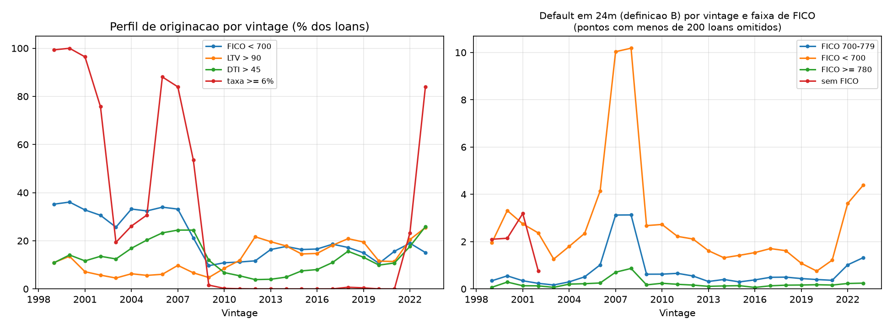

# Relatorio de EDA

Gerado em 2026-11-07 13:06 por `uv run poe eda-report` (somente agregados). Alvo: `target_24m` (D-002, definicao B). Populacao: `usable_24m`, vintages 1999-2023 (1.244.442 loans, 13.428 defaults, taxa media 1.08%).

## 1. Poder discriminatorio (IV univariado)
IV = soma de (%bons - %maus) x WoE por faixa. Leitura usual: < 0,02 sem poder; 0,02-0,1 fraco; 0,1-0,3 medio; 0,3-0,5 forte; > 0,5 suspeito. Calculado sobre todas as vintages juntas (mistura ciclos): serve para ordenar variaveis, nao para estimar efeitos.

| variavel | faixas | IV | leitura |
|---|---|---|---|
| fico_band | 7 | 1.039 | suspeito (>0,5) |
| rate_band | 6 | 0.525 | suspeito (>0,5) |
| ltv_band | 7 | 0.256 | medio |
| dti_band | 7 | 0.250 | medio |
| number_of_borrowers | 6 | 0.196 | medio |
| channel | 5 | 0.187 | medio |
| mi_band | 5 | 0.162 | medio |
| property_state | 54 | 0.077 | fraco (muitas faixas) |
| property_valuation_method | 4 | 0.036 | fraco |
| property_type | 6 | 0.028 | fraco |
| loan_purpose | 4 | 0.021 | fraco |
| upb_band | 5 | 0.007 | sem poder |
| harp_indicator | 2 | 0.007 | sem poder |
| special_eligibility_program | 4 | 0.006 | sem poder |
| number_of_units | 5 | 0.004 | sem poder |
| occupancy_status | 3 | 0.004 | sem poder |
| first_time_homebuyer_flag | 3 | 0.003 | sem poder |
| prepayment_penalty_flag | 2 | 0.001 | sem poder |
| io_indicator | 1 | 0.000 | sem poder |

## 2. Perfis de risco das 4 variaveis mais fortes
| feature | bucket | n_loans | n_defaults | share | default_rate | lift |
|---|---|---|---|---|---|---|
| dti_band | a <=20 | 142.126 | 623 | 11.42% | 0.44% | 0.41 |
| dti_band | b 21-30 | 289.934 | 1.817 | 23.30% | 0.63% | 0.58 |
| dti_band | c 31-40 | 363.382 | 3.564 | 29.20% | 0.98% | 0.91 |
| dti_band | d 41-45 | 190.452 | 2.586 | 15.30% | 1.36% | 1.26 |
| dti_band | e 46-50 | 118.015 | 1.888 | 9.48% | 1.60% | 1.48 |
| dti_band | f >50 | 45.316 | 1.553 | 3.64% | 3.43% | 3.18 |
| dti_band | z missing | 95.217 | 1.397 | 7.65% | 1.47% | 1.36 |
| fico_band | a <620 | 23.752 | 1.683 | 1.91% | 7.09% | 6.57 |
| fico_band | b 620-659 | 74.905 | 3.039 | 6.02% | 4.06% | 3.76 |
| fico_band | c 660-699 | 167.485 | 3.469 | 13.46% | 2.07% | 1.92 |
| fico_band | d 700-739 | 261.771 | 2.780 | 21.04% | 1.06% | 0.98 |
| fico_band | e 740-779 | 367.309 | 1.680 | 29.52% | 0.46% | 0.42 |
| fico_band | f >=780 | 347.177 | 737 | 27.90% | 0.21% | 0.20 |
| fico_band | z missing | 2.043 | 40 | 0.16% | 1.96% | 1.81 |
| ltv_band | a <=60 | 309.262 | 1.475 | 24.85% | 0.48% | 0.44 |
| ltv_band | b 61-70 | 178.411 | 1.594 | 14.34% | 0.89% | 0.83 |
| ltv_band | c 71-80 | 475.566 | 4.751 | 38.22% | 1.00% | 0.93 |
| ltv_band | d 81-90 | 123.121 | 2.233 | 9.89% | 1.81% | 1.68 |
| ltv_band | e 91-95 | 115.537 | 2.108 | 9.28% | 1.82% | 1.69 |
| ltv_band | f >95 | 42.502 | 1.267 | 3.42% | 2.98% | 2.76 |
| ltv_band | z missing | 43 | 0 | 0.00% | 0.00% | 0.00 |
| rate_band | a <3 | 63.193 | 143 | 5.08% | 0.23% | 0.21 |
| rate_band | b 3-3.99 | 222.059 | 708 | 17.84% | 0.32% | 0.30 |
| rate_band | c 4-4.99 | 326.818 | 1.799 | 26.26% | 0.55% | 0.51 |
| rate_band | d 5-5.99 | 244.303 | 2.478 | 19.63% | 1.01% | 0.94 |
| rate_band | e 6-6.99 | 246.856 | 5.080 | 19.84% | 2.06% | 1.91 |
| rate_band | f >=7 | 141.213 | 3.220 | 11.35% | 2.28% | 2.11 |

## 3. FICO x LTV por era

## 4. Por que 2022-2023 destoam? Perfil (mix) versus risco dentro do perfil
| medida | taxa_24m |
|---|---|
| taxa 2012-2017 (base) | 0.50% |
| taxa esperada em 2022-2023 se so o PERFIL (mix FICO x LTV) mudasse | 0.51% |
| taxa observada em 2022-2023 | 1.37% |

Efeito do PERFIL (FICO x LTV): +0.01 p.p.; efeito RESIDUAL (risco dentro das mesmas celulas, assistencia nao marcada, macro): +0.87 p.p.

## 5. `property_valuation_method`: proxy de tempo?
Se a ausencia for ~100% ate certa vintage e cair depois, a variavel identifica a EPOCA e vaza tempo no split por vintage.

| vintage | loans | pct_sem_informacao | taxa_24m_B |
|---|---|---|---|
| 1999 | 49.250 | 100.00% | 0.90% |
| 2000 | 48.600 | 100.00% | 1.54% |
| 2001 | 49.667 | 100.00% | 1.12% |
| 2002 | 49.717 | 100.00% | 0.87% |
| 2003 | 49.797 | 100.00% | 0.43% |
| 2004 | 49.599 | 100.00% | 0.78% |
| 2005 | 49.656 | 100.00% | 1.05% |
| 2006 | 49.652 | 100.00% | 1.92% |
| 2007 | 49.713 | 100.00% | 4.90% |
| 2008 | 49.772 | 100.00% | 3.98% |
| 2009 | 49.941 | 100.00% | 0.63% |
| 2010 | 49.963 | 100.00% | 0.69% |
| 2011 | 49.956 | 100.00% | 0.63% |
| 2012 | 49.953 | 100.00% | 0.56% |
| 2013 | 49.923 | 100.00% | 0.45% |
| 2014 | 49.900 | 100.00% | 0.47% |
| 2015 | 49.900 | 100.00% | 0.43% |
| 2016 | 49.913 | 100.00% | 0.47% |
| 2017 | 49.886 | 99.11% | 0.61% |
| 2018 | 49.903 | 96.97% | 0.59% |
| 2019 | 49.915 | 89.11% | 0.45% |
| 2020 | 49.952 | 0.00% | 0.35% |
| 2021 | 49.984 | 0.00% | 0.43% |
| 2022 | 49.979 | 0.00% | 1.30% |
| 2023 | 49.951 | 0.00% | 1.45% |

## 6. Calibracao das exclusoes (toda a populacao com janela de 24 meses, incluindo excluidos)
`taxa_alguma_vez` (qualquer idade) e a medida robusta: nos loans com 1o pagamento inconsistente a idade esta errada e a taxa de 24 meses nao e confiavel.

| check_name | bucket | n_loans | pct_dos_loans | n_defaults_24m | taxa_24m | n_ever_default | taxa_alguma_vez |
|---|---|---|---|---|---|---|---|
| first_row_age | c 2-3 | 30.858 | 2.47% | 399 | 1.29% | 1.573 | 5.10% |
| first_row_age | e >12 | 13.703 | 1.10% | 16 | 0.12% | 532 | 3.88% |
| first_row_age | b 1 | 105.075 | 8.41% | 983 | 0.94% | 4.339 | 4.13% |
| first_row_age | d 4-12 | 12.649 | 1.01% | 151 | 1.19% | 908 | 7.18% |
| first_row_age | a <=0 | 1.087.677 | 87.02% | 11.950 | 1.10% | 45.048 | 4.14% |
| first_payment_months | c >8 | 5.520 | 0.44% | 71 | 1.29% | 207 | 3.75% |
| first_payment_months | b 6-8 | 1.455 | 0.12% | 16 | 1.10% | 44 | 3.02% |
| first_payment_months | a 0-5 | 1.242.987 | 99.44% | 13.412 | 1.08% | 52.149 | 4.20% |

## 7. Insights
_(a preencher: crie `docs/eda_insights.md` no formato Observacao, Evidencia, Por que, Implicacao; ele sera incluido aqui a cada execucao)_
