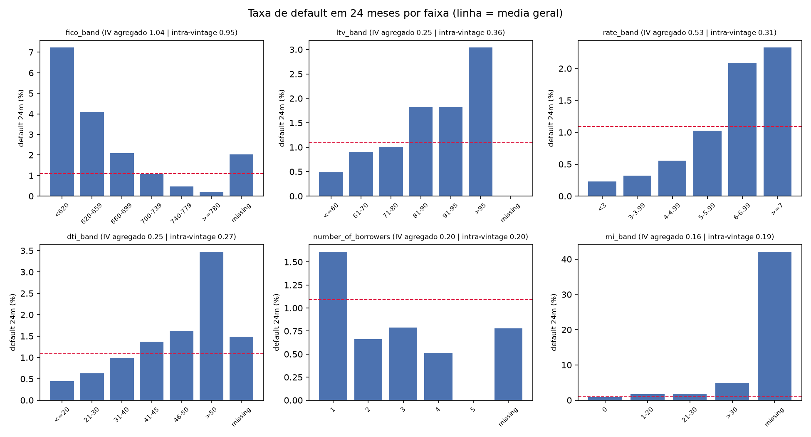
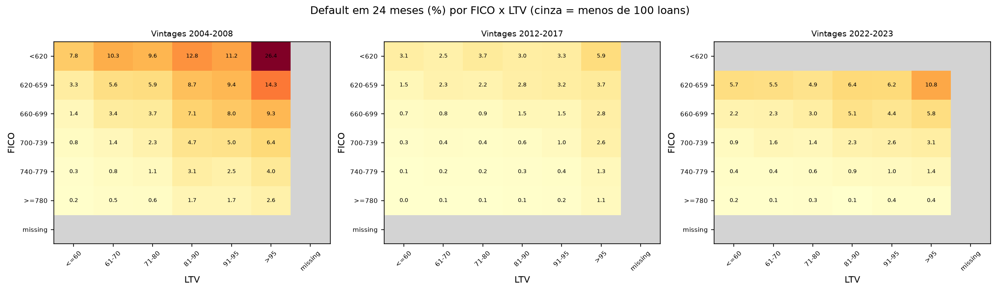
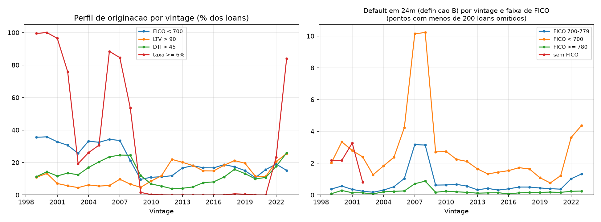

# Relatorio de EDA

Gerado em 2026-11-12 17:33 por `uv run poe eda-report` (somente agregados). Alvo: `target_24m` (D-002, definicao B). Populacao: `usable_24m`, vintages 1999-2023 (1.219.050 loans, 13.269 defaults, taxa media 1.09%).

## 1. Poder discriminatorio (IV univariado)
IV = soma de (%bons - %maus) x WoE por faixa, **corrigido do ruido amostral** (subtrai o IV esperado de uma variavel independente do alvo, que cresce com o numero de faixas e com poucos defaults). Leitura usual do agregado: < 0,02 sem poder; 0,02-0,1 fraco; 0,1-0,3 medio; 0,3-0,5 forte; > 0,5 suspeito. **`IV_agregado` mistura todas as vintages** e pode ser inflado por variaveis que apenas identificam a EPOCA. **`IV_intra_vintage`** (media dos IV de cada vintage, ponderada pelos defaults) remove esse efeito: se `razao_intra_agregado` < 0,6, a variavel esta confundida com a epoca. As colunas por era mostram a estabilidade do poder ao longo do tempo.

| variavel | faixas | IV_agregado | IV_intra_vintage | razao_intra_agregado | 1999-2003 | 2004-2008 | 2009-2011 | 2012-2017 | 2018-2021 | 2022-2023 | leitura |
|---|---|---|---|---|---|---|---|---|---|---|---|
| fico_band | 7 | 1.040 | 0.951 | 0.91 | 1.348 | 0.770 | 0.937 | 0.948 | 0.519 | 0.929 | estavel |
| rate_band | 6 | 0.529 | 0.311 | 0.59 | 0.461 | 0.501 | 0.647 | 0.362 | 0.154 | 0.043 | confundida com a epoca |
| ltv_band | 7 | 0.254 | 0.363 | 1.43 | 0.504 | 0.355 | 0.898 | 0.422 | 0.088 | 0.065 | estavel |
| dti_band | 7 | 0.249 | 0.266 | 1.06 | 0.129 | 0.223 | 0.835 | 0.486 | 0.116 | 0.105 | estavel |
| number_of_borrowers | 6 | 0.196 | 0.200 | 1.02 | 0.259 | 0.231 | 0.154 | 0.190 | 0.192 | 0.159 | estavel |
| channel | 5 | 0.189 | 0.091 | 0.48 | 0.134 | 0.109 | 0.110 | 0.028 | 0.008 | 0.000 | confundida com a epoca |
| mi_band | 5 | 0.160 | 0.188 | 1.18 | 0.414 | 0.244 | 0.078 | 0.065 | 0.054 | 0.048 | estavel |
| property_state | 54 | 0.073 | 0.146 | 2.00 | 0.145 | 0.135 | 0.123 | 0.086 | 0.036 | 0.017 | estavel (muitas faixas) |
| property_valuation_method | 4 | 0.037 | 0.009 | 0.24 | 0.000 | 0.000 | 0.000 | 0.000 | 0.038 | 0.072 | confundida com a epoca |
| property_type | 6 | 0.028 | 0.024 | 0.85 | 0.035 | 0.006 | 0.010 | 0.009 | 0.021 | 0.037 | estavel |
| loan_purpose | 4 | 0.022 | 0.050 | 2.29 | 0.022 | 0.012 | 0.128 | 0.040 | 0.015 | 0.061 | estavel |
| upb_band | 5 | 0.007 | 0.047 | 6.38 | 0.082 | 0.046 | 0.035 | 0.031 | 0.037 | 0.049 | sem poder |
| harp_indicator | 2 | 0.007 | 0.095 | 14.12 | 0.000 | 0.000 | 0.585 | 0.302 | 0.015 | 0.000 | sem poder |
| special_eligibility_program | 4 | 0.006 | 0.015 | 2.69 | 0.000 | 0.000 | 0.000 | 0.029 | 0.080 | 0.074 | sem poder |
| occupancy_status | 3 | 0.004 | 0.017 | 4.15 | 0.014 | 0.011 | 0.006 | 0.010 | 0.004 | 0.068 | sem poder |
| number_of_units | 5 | 0.004 | 0.005 | 1.26 | 0.002 | 0.007 | 0.000 | 0.000 | 0.000 | 0.002 | sem poder |
| first_time_homebuyer_flag | 3 | 0.003 | 0.011 | 4.27 | 0.012 | 0.006 | 0.012 | 0.004 | 0.040 | 0.000 | sem poder |
| io_indicator | 1 | 0.000 | 0.000 |  | 0.000 | 0.000 | 0.000 | 0.000 | 0.000 | 0.000 | sem poder |
| prepayment_penalty_flag | 2 | 0.000 | 0.000 |  | 0.000 | 0.000 | 0.000 | 0.000 | 0.000 | 0.000 | sem poder |

## 2. Perfis de risco das 4 variaveis mais fortes
| feature | bucket | n_loans | n_defaults | share | default_rate | lift |
|---|---|---|---|---|---|---|
| dti_band | a <=20 | 138.884 | 613 | 11.39% | 0.44% | 0.41 |
| dti_band | b 21-30 | 283.617 | 1.794 | 23.27% | 0.63% | 0.58 |
| dti_band | c 31-40 | 355.712 | 3.520 | 29.18% | 0.99% | 0.91 |
| dti_band | d 41-45 | 187.218 | 2.555 | 15.36% | 1.36% | 1.25 |
| dti_band | e 46-50 | 116.345 | 1.871 | 9.54% | 1.61% | 1.48 |
| dti_band | f >50 | 44.195 | 1.535 | 3.63% | 3.47% | 3.19 |
| dti_band | z missing | 93.079 | 1.381 | 7.64% | 1.48% | 1.36 |
| fico_band | a <620 | 22.896 | 1.654 | 1.88% | 7.22% | 6.64 |
| fico_band | b 620-659 | 73.285 | 2.995 | 6.01% | 4.09% | 3.75 |
| fico_band | c 660-699 | 164.117 | 3.435 | 13.46% | 2.09% | 1.92 |
| fico_band | d 700-739 | 256.237 | 2.755 | 21.02% | 1.08% | 0.99 |
| fico_band | e 740-779 | 359.663 | 1.661 | 29.50% | 0.46% | 0.42 |
| fico_band | f >=780 | 340.875 | 729 | 27.96% | 0.21% | 0.20 |
| fico_band | z missing | 1.977 | 40 | 0.16% | 2.02% | 1.86 |
| ltv_band | a <=60 | 302.601 | 1.461 | 24.82% | 0.48% | 0.44 |
| ltv_band | b 61-70 | 174.681 | 1.574 | 14.33% | 0.90% | 0.83 |
| ltv_band | c 71-80 | 465.017 | 4.685 | 38.15% | 1.01% | 0.93 |
| ltv_band | d 81-90 | 121.292 | 2.209 | 9.95% | 1.82% | 1.67 |
| ltv_band | e 91-95 | 114.257 | 2.089 | 9.37% | 1.83% | 1.68 |
| ltv_band | f >95 | 41.162 | 1.251 | 3.38% | 3.04% | 2.79 |
| ltv_band | z missing | 40 | 0 | 0.00% | 0.00% | 0.00 |
| rate_band | a <3 | 62.957 | 143 | 5.16% | 0.23% | 0.21 |
| rate_band | b 3-3.99 | 219.119 | 706 | 17.97% | 0.32% | 0.30 |
| rate_band | c 4-4.99 | 321.411 | 1.795 | 26.37% | 0.56% | 0.51 |
| rate_band | d 5-5.99 | 239.846 | 2.460 | 19.67% | 1.03% | 0.94 |
| rate_band | e 6-6.99 | 239.755 | 5.001 | 19.67% | 2.09% | 1.92 |
| rate_band | f >=7 | 135.962 | 3.164 | 11.15% | 2.33% | 2.14 |

## 3. FICO x LTV por era

## 4. Por que 2022-2023 destoam? Perfil (mix) versus risco dentro do perfil
Aplica as taxas por CELULA de 2012-2017 ao perfil de 2022-2023. `taxa esperada` = o que 2022-2023 teria se so o PERFIL mudasse; o que sobra e risco dentro das mesmas celulas (macro, assistencia nao marcada, outros fatores). Celulas mais finas controlam mais variaveis.

| definicao_de_celula | n_cells | base_rate | expected_rate | actual_rate | mix_effect | rate_effect | excesso_residual |
|---|---|---|---|---|---|---|---|
| taxa de juros apenas | 6 | 0.51% | 0.63% | 1.37% | 0.12% | 0.74% | 85.69% |
| fico x ltv | 44 | 0.51% | 0.51% | 1.37% | 0.00% | 0.86% | 99.88% |
| fico x ltv x dti | 236 | 0.51% | 0.48% | 1.37% | -0.03% | 0.89% | 103.53% |
| fico x ltv x dti x taxa | 1141 | 0.51% | 0.55% | 1.37% | 0.04% | 0.82% | 95.41% |

Controlando por FICO, LTV, DTI e taxa de juros ao mesmo tempo, **95.41% do excesso** de 2022-2023 sobre 2012-2017 (+0.86 p.p.) permanece como risco residual dentro das mesmas celulas.

## 5. `property_valuation_method`: proxy de tempo?
Se a ausencia for ~100% ate certa vintage e cair depois, a variavel identifica a EPOCA e vaza tempo no split por vintage.

| vintage | loans | pct_sem_informacao | taxa_24m_B |
|---|---|---|---|
| 1999 | 45.289 | 100.00% | 0.95% |
| 2000 | 46.520 | 100.00% | 1.55% |
| 2001 | 48.430 | 100.00% | 1.14% |
| 2002 | 48.615 | 100.00% | 0.88% |
| 2003 | 48.571 | 100.00% | 0.43% |
| 2004 | 48.429 | 100.00% | 0.79% |
| 2005 | 48.435 | 100.00% | 1.06% |
| 2006 | 47.327 | 100.00% | 1.98% |
| 2007 | 47.662 | 100.00% | 4.98% |
| 2008 | 49.524 | 100.00% | 3.99% |
| 2009 | 49.668 | 100.00% | 0.63% |
| 2010 | 49.603 | 100.00% | 0.69% |
| 2011 | 49.361 | 100.00% | 0.64% |
| 2012 | 48.937 | 100.00% | 0.57% |
| 2013 | 48.383 | 100.00% | 0.47% |
| 2014 | 48.651 | 100.00% | 0.49% |
| 2015 | 48.358 | 100.00% | 0.44% |
| 2016 | 49.459 | 100.00% | 0.47% |
| 2017 | 49.304 | 99.10% | 0.62% |
| 2018 | 49.060 | 96.92% | 0.60% |
| 2019 | 49.719 | 89.08% | 0.45% |
| 2020 | 49.929 | 0.00% | 0.35% |
| 2021 | 49.937 | 0.00% | 0.43% |
| 2022 | 49.954 | 0.00% | 1.30% |
| 2023 | 49.925 | 0.00% | 1.45% |

## 6. Calibracao das exclusoes (toda a populacao com janela de 24 meses, incluindo excluidos)
`taxa_alguma_vez` (qualquer idade) e a medida robusta: nos loans com 1o pagamento inconsistente a idade esta errada e a taxa de 24 meses nao e confiavel.

| check_name | bucket | n_loans | pct_dos_loans | n_defaults_24m | taxa_24m | n_ever_default | taxa_alguma_vez |
|---|---|---|---|---|---|---|---|
| first_row_age | c 2-3 | 30.858 | 2.47% | 399 | 1.29% | 1.573 | 5.10% |
| first_row_age | e >12 | 13.703 | 1.10% | 16 | 0.12% | 532 | 3.88% |
| first_row_age | b 1 | 105.075 | 8.41% | 983 | 0.94% | 4.339 | 4.13% |
| first_row_age | d 4-12 | 12.649 | 1.01% | 151 | 1.19% | 908 | 7.18% |
| first_row_age | a <=0 | 1.087.677 | 87.02% | 11.950 | 1.10% | 45.048 | 4.14% |
| first_payment_months | c >8 | 5.520 | 0.44% | 71 | 1.29% | 207 | 3.75% |
| first_payment_months | b 6-8 | 1.455 | 0.12% | 16 | 1.10% | 44 | 3.02% |
| first_payment_months | a 0-5 | 1.242.987 | 99.44% | 13.412 | 1.08% | 52.149 | 4.20% |

## 7. Insights
> Rascunho escrito a partir do relatório de EDA executado nos dados reais (versão anterior à exclusão de entrada tardia).
> **Revise e ajuste.** Os números vão mudar um pouco na próxima execução (ver insight 8). Formato: Observação → Evidência → Por quê → Implicação.

### 1. O FICO é o principal discriminador, com gradiente monótono
- **Evidência:** a taxa de default em 24 meses vai de 7,09% (FICO < 620) a 0,21% (≥ 780), um fator de ~34 (lift 6,57 contra 0,20). IV agregado = 1,04.
- **Por quê:** o score resume o histórico de crédito do tomador.
- **Implicação:** variável central do scorecard. Usar faixas monótonas e uma faixa própria para "sem FICO" (0,16% dos loans, risco 1,96%, parecido com a faixa 660-699).

### 2. DTI e LTV elevam o risco, mas as faixas altas se parecem
- **Evidência:** DTI > 50 chega a 3,43% (lift 3,18) com só 3,64% dos loans; LTV > 95 chega a 2,98%. As faixas de LTV 81-90 e 91-95 são praticamente iguais (1,81% e 1,82%).
- **Implicação:** o binning deve agrupar LTV 81-95 e respeitar monotonicidade; o risco só se separa de verdade acima de 95 (loans HARP e de LTV extremo).

### 3. DTI ausente não é aleatório
- **Evidência:** 7,65% dos loans não têm DTI e têm risco de 1,47% (lift 1,36), entre as faixas 41-45 e 46-50.
- **Implicação:** manter "DTI ausente" como categoria própria no WoE, em vez de imputar. O flag `dti_was_missing` já existe na silver.

### 4. A taxa de juros discrimina, mas o IV agregado exagera
- **Evidência:** o risco sobe de 0,23% (taxa < 3%) a 2,28% (≥ 7%) e o IV agregado é 0,525. A taxa embute o preço do risco **e** a época (vintages de 2000, 2006-2008 e 2022-2023 têm taxas altas).
- **Implicação:** decidir por `IV_intra_vintage` e pela razão intra/agregado do relatório novo, não pelo agregado. Se a taxa se confirmar como proxy de época, tratá-la como variável de mercado com cuidado no split temporal.

### 5. Várias variáveis não têm poder
- **Evidência:** `upb_band`, `harp_indicator`, `special_eligibility_program`, `number_of_units`, `occupancy_status`, `first_time_homebuyer_flag` e `prepayment_penalty_flag` têm IV ≤ 0,007, e `io_indicator` tem uma única faixa (constante).
- **Implicação:** candidatas a remoção. O fato de `occupancy_status` não ter poder é contraintuitivo (imóveis de investimento costumam ser mais arriscados): checar por era antes de descartar.

### 6. `property_valuation_method` é um relógio, não uma variável de risco
- **Evidência:** a ausência é 100% de 1999 a 2016, 99,11% em 2017, 96,97% em 2018, 89,11% em 2019 e **0% de 2020 em diante**. O IV de 0,036 é espúrio.
- **Implicação:** excluir do scorecard (D-009 confirmada). O mesmo raciocínio vale para qualquer variável cuja disponibilidade mude no tempo.

### 7. O perfil de originação não explica o excesso de 2022-2023
- **Evidência:** controlando por FICO × LTV, a taxa esperada para 2022-2023 seria 0,51% (base 2012-2017: 0,50%) e a observada é 1,37%. O efeito do perfil é +0,01 p.p. e o residual é **+0,87 p.p.**
- **Por quê (hipóteses):** macro (juros e custos de moradia), assistência não marcada, ou DTI e taxa de juros, que não entraram nessa primeira padronização. A versão nova do relatório controla DTI e taxa de forma aninhada.
- **Implicação:** o scorecard deve manter bom *ranking* nessas safras, mas provavelmente descalibrar. Planejar recalibração por época e monitorar PSI.

### 8. Entrada tardia é viés de sobrevivente
- **Evidência:** loans cuja primeira linha de performance tem idade > 12 (13.703) mostram 24m = 0,12%, contra 1,08% na média, mas "alguma vez" = 3,88%, normal. Os de idade 4 a 12 (12.649) têm a maior taxa "alguma vez": 7,18%.
- **Por quê:** a vida inicial desses empréstimos não foi observada, e um default 90+ só pode ocorrer a partir do 3º ou 4º mês. Quem entra até a idade 3 não perde nenhum default.
- **Implicação:** excluir `first_row_age > 3` do treino (D-010; 26.352 loans, 2,1%).

### 9. A regra do primeiro pagamento é segura
- **Evidência:** os loans com primeiro pagamento > 8 meses após o trimestre do `loan_id` (5.520) têm 24m = 1,29% e "alguma vez" = 3,75%; a faixa 6-8 (1.455) tem 1,10% e 3,02%; o normal (0-5) tem 1,08% e 4,20%.
- **Implicação:** o risco é parecido, então a exclusão não distorce a taxa. Manter a regra 0-8 (D-007 confirmada).

### 10. Os eventos se concentram na crise
- **Evidência:** cerca de 40% dos defaults de 24 meses estão em três vintages (2006: 968, 2007: 2.449, 2008: 1.987, de 13.499 antes das exclusões).
- **Implicação:** o split out-of-time precisa manter a crise no treino, senão o modelo nunca vê estresse. Reportar métricas **por vintage** e nunca usar split aleatório.

### 11. Muitas faixas inflam o IV por ruído
- **Evidência:** `property_state` tem 54 faixas e IV agregado de 0,077. Por vintage (~200 defaults em safras benignas) o ruído amostral esperado passa de 0,2.
- **Implicação:** o relatório novo subtrai esse ruído (IV corrigido). Para estado, preferir agrupamentos por risco (regiões ou clusters) em vez de 54 dummies.

### 12. Canal, número de mutuários e MI são candidatos médios
- **Evidência:** `number_of_borrowers` (IV 0,196), `channel` (0,187) e `mi_band` (0,162).
- **Implicação:** `mi_band` tende a ser colinear com LTV: checar correlação antes de incluir os dois.

## Decisões decorrentes (copie para `docs/decision_log.md`)
- **D-007 (confirmada pela EDA):** manter a exclusão de 1º pagamento fora de 0-8 meses; os loans excluídos têm risco parecido com os demais.
- **D-009 (confirmada):** `property_valuation_method` fora do scorecard (proxy de época); `vantage_score_4` removida.
- **D-010 (nova):** excluir do treino loans com `first_row_age > 3` (entrada tardia, viés de sobrevivente). Já implementado em `excluded_reason = 'late_entry'`.
- **D-011 (nova):** selecionar variáveis por IV corrigido do ruído e por IV intra-vintage, não pelo IV agregado.
